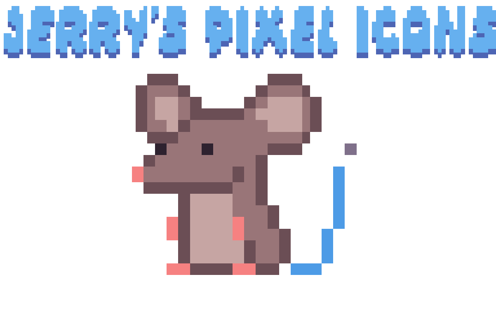

<!--
repo name: jerrys-pixel-ixons
description: An awesome pixel-art icons theme for your file explorer
github name:  wolfsouldev
link: https://github.com/wolfsouldev/jerrys-pixel-icons/issues
logo path: assets/logo.png
-->

<!-- PROJECT LOGO -->
<br />
<p align="center">
    <a href="https://github.com/wolfsouldev/jerrys-pixel-icons">
        
    </a>
<div align="center">

![Version][version-shield]
[![Contributors][contributors-shield]][contributors-url]
[![Stargazers][stars-shield]][stars-url]
[![MIT License][license-shield]][license-url]
</div>
    <p align="center">
        A Visual Studio Code extension that adds pixel art-style icons to your file explorer. Give your favorite editor a fun touch!
        <br />
        <a href="https://marketplace.visualstudio.com/items?itemName=MelissaGutierrez.jerrys-pixel-icons&ssr=false#overview"><strong>★ Visual studio market place ★</strong></a>
        <br />
        <br />
        <a href="https://github.com/wolfsouldev/jerrys-pixel-icons/issues">Report Bug</a>
        •
        <a href="https://github.com/wolfsouldev/jerrys-pixel-icons/issues/new?template=icon-request.yml">Request Icon</a>
    </p>
</p>

<!-- TABLE OF CONTENTS -->
## Table of Contents

- [Table of Contents](#table-of-contents)
- [Some Examples](#some-examples)
- [Getting Started](#getting-started)
  - [Prerequisites](#prerequisites)
  - [Installation](#installation)
  - [Activating The Extension](#activating-the-extension)
- [Reporting Issues](#reporting-issues)
- [Contributing](#contributing)
- [Icon Gallery](#icon-gallery)
- [License](#license)
- [Contact](#contact)

<!-- SOME EXAMPLES -->
## Some Examples

![Examples][examples]

<!-- GETTING STARTED -->
## Getting Started

### Prerequisites

* [VS Code](https://code.visualstudio.com) v1.105.0 or superior

### Installation

1. Open VS Code
2. Go to the Extensions tab `Ctrl+Shift+X`
3. Search for "Jerry's Pixel Icons"
4. Click Install

Or install directly from the [VS Code Marketplace](https://marketplace.visualstudio.com/items?itemName=MelissaGutierrez.jerrys-pixel-icons&ssr=false#overview)


### Activating the Extension

1. Press `Ctrl+Shift+P`
2. Type "File Icon Theme"
3. Select "Jerry's Pixel"

<!-- REPORT AN ISSUE -->
## Reporting Issues

If you find any issues or have suggestions, please contact us:

1. Go to the [GitHub repository](https://github.com/wolfsouldev/jerrys-pixel-icons)
2. Open an issue
3. Include:
   - Description of the problem
   - Screenshot (if applicable)
   - VS Code version

<!-- CONTRIBUTING -->
## Contributing

Any contributions you make are **greatly appreciated**.

1. Fork the Project
2. Create your Feature Branch (`git checkout -b feature/AmazingFeature`)
3. Commit your Changes (`git commit -m 'Add some AmazingFeature'`)
4. Push to the Branch (`git push origin feature/AmazingFeature`)
5. Open a Pull Request

Read the [contributor guide](CONTRIBUTING.md) for the source catalog, pixel-art
grid and palette, SVG export, naming rules, visual checks, and PR checklist.
New icons should use a 16×16 logical grid and be delivered as SVG assets.

**Edit `catalog/icons.json`, not the generated `themes/icon-theme.json`.**
Folder names are declared once; the generator creates both closed and open mappings.

### Development checks

With Node.js 22 or 24 and pnpm 12.15.0 (pinned in `package.json`):

```sh
pnpm install --frozen-lockfile --ignore-scripts
pnpm run generate
pnpm test
pnpm run package
```

This is a declarative icon theme: no TypeScript compilation or `src/` directory is needed.
`pnpm run generate:check` detects stale generated output without modifying files.
`pnpm run validate` checks that output, icon references, SVG XML, unsupported
glob patterns, duplicate case-insensitive associations, and matching closed/open folder names.
`pnpm test` also runs linting and regression tests. Packaging runs these checks again
and creates a local `.vsix`, then verifies its actual contents; it does not publish
the extension. GitHub Actions runs these checks on pushes and pull requests with
Node.js 22 and 24, keeping the verified packages as downloadable build artifacts.

Use exact names in `fileNames` (for example, `favicon.svg`) and compound extensions
in `fileExtensions` (for example, `module.ts` or `routes.ts`), not glob patterns.
These generated fields come from `files[].names` and `files[].extensions` in the catalog.
Routing files such as `route.ts`, `router.js`, and `urls.py` are mapped explicitly;
arbitrary names such as `appRouter.ts` keep their normal language icon.

Press `F5` to validate the theme and open an Extension Development Host. Select
**Jerry's Pixel** under **Preferences: File Icon Theme** and visually inspect both
closed and expanded folders. Automated checks do not replace this rendering check.

<!-- LICENSE -->
## Icon Gallery

Explore the collection locally, with search, file/folder filters, open-folder
previews, light/dark backgrounds, association details and original SVG downloads:

```sh
pnpm run gallery:preview
```

Open **http://127.0.0.1:4173**. The gallery reads the same source catalog as the theme.
`pnpm run gallery:build` creates a self-contained static site in `dist/gallery/`;
it is excluded from the VSIX. Local build/preview commands do not deploy anything.
Once GitHub Pages is enabled with **GitHub Actions** as the publishing source,
pushes to `master` deploy the gallery only after the Node matrix and browser checks
pass. Pull requests never deploy. A final HTTP check verifies the published files
against the tested commit.
See the [gallery guide](gallery/README.md) for setup, browser tests, publication and
optional custom domains. The default expected URL is
`https://wolfsouldev.github.io/jerrys-pixel-icons/`.

## License

Distributed under the MIT License. See `LICENSE` for more information.
Icon-specific attribution and license exceptions (Angular and Kubernetes artwork)
are documented in [ICON_NOTICES.txt](ICON_NOTICES.txt), also included in the gallery
and VSIX. Brand names and trademarks belong to their respective owners.


<!-- CONTACT -->
## Contact

 ★ Developer - [linkedin.com/in/alejandro-fajardo](https://www.linkedin.com/in/alejandro-fajardo-1548a0245)

 ★ Icon Artist - [linkedin.com/in/melissa-gutierrez](https://www.linkedin.com/in/melissa-gutierrez-47356b2b6/)

 ★ Project Link: [https://github.com/wolfsouldev/jerrys-pixel-icons](https://github.com/wolfsouldev/jerrys-pixel-icons)


<!-- MARKDOWN LINKS & IMAGES -->
[version-shield]: https://img.shields.io/badge/version-0.3.0-blue.svg?style=flat-square
[contributors-shield]: https://img.shields.io/github/contributors/wolfsouldev/jerrys-pixel-icons.svg?style=flat-square
[contributors-url]: https://github.com/wolfsouldev/jerrys-pixel-icons/graphs/contributors
[stars-shield]: https://img.shields.io/github/stars/wolfsouldev/jerrys-pixel-icons.svg?style=flat-square
[stars-url]: https://github.com/wolfsouldev/jerrys-pixel-icons/stargazers
[license-shield]: https://img.shields.io/github/license/wolfsouldev/jerrys-pixel-icons.svg?style=flat-square
[license-url]: https://github.com/wolfsouldev/jerrys-pixel-icons/blob/master/LICENSE
[examples]: https://raw.githubusercontent.com/wolfsouldev/jerrys-pixel-icons/refs/heads/master/assets/example.webp
